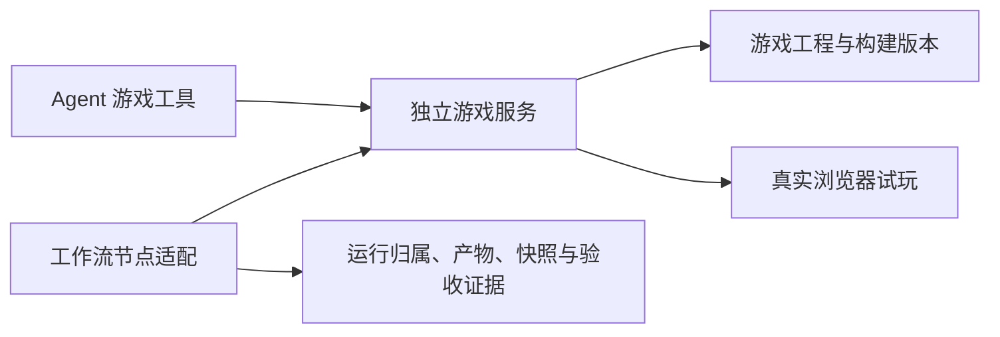

# Cinderwatch 三维塔防模板

工作台的新游戏验证基线是 `cinderwatch@1`。它保留完整的微缩沙盘、四类防御塔与升级、敌人及 Boss、五种地貌、规则式自动指挥、手动接管和地形坍塌重建。交付物是内嵌 Three.js r170 的单文件离线 HTML。

## 工具与节点



`src/host/native-game-service.mjs` 是双方共用的游戏操作接口。它按产品注册表定位工作区，执行创建、构建、预览、试玩、源码候选和导出，不接收工作流的运行 ID、节点 ID、审批包或上游产物。游戏构建版本仍保存在工程内，用于精确预览、回退和导出；这些版本属于游戏本身，不是工作流节点快照。

`native-game-tools.ts` 注册 Agent 工具，默认仅返回工程、构建 ID、状态、必要路径和预览链接。源码、完整 manifest、base64、工作流归属和节点快照不出现在普通工具回执中。版本比较仍提供增加/删除行数和变化字段，CAS 操作可以显式查询当前指纹。

`workflow-native-game.mjs` 调用同一服务，再补充获批参数核对、运行/尝试归属和上游凭据检查。`workflow-runner.mjs` 负责节点 journal、产物采用与工作流快照。模型文字不能替代真实操作结果。

## 独立创建

Agent 可以直接调用，无需先创建工作流：

```json
{
  "productId": "实际产品ID",
  "slug": "cinderwatch-demo",
  "title": "余烬守望",
  "template": "cinderwatch",
  "rules": {
    "seed": 4,
    "biome": "ashen",
    "startingGold": 300,
    "lives": 20,
    "autoCommand": true
  }
}
```

工具名是 `workbench_game_create`。省略 template 时默认 Cinderwatch，省略 rules 时使用以上参数；默认横屏。产品必须已配置有效工作区，新工程位于 `games/<slug>`，不允许模型传任意绝对路径。之后使用实际返回的 slug/buildId 调用 build、preview、playtest 或 export。

| 参数 | 范围 | 作用 |
| --- | --- | --- |
| seed | 整数 1–999999 | 固定地图生成种子 |
| biome | ashen / frost / fen / ember / dunes | 起始地貌，后续地图继续轮换 |
| startingGold | 整数 70–2000 | 每块地图的基础初始金币，仍有正常层数增量 |
| lives | 整数 1–100 | 基地初始及最大生命 |
| autoCommand | 布尔值 | 开局使用自动指挥或手动指挥 |

玩家用鼠标或触屏选塔位，数字键 1–4 选塔，U 升级，C 切换指挥，P 暂停，Space 提前叫波；移动/缩放与原游戏一致。塔防是连续防守循环，没有采集模板的 `won` 终局。

## 工作流验证

在工作流模板库选择 `game-cinderwatch-test`，或使用默认的游戏产品完整流程。预填需求涵盖塔防配置、设计批准、原型试玩、最终构建、最终试玩、离线导出及人工验收。批准 JSON 须含 `nativeTemplate="cinderwatch@1"` 和全部五个参数。

自动试玩在真实浏览器里用鼠标、键盘和触屏操作。桌面战斗按原逻辑固定步进，检查 WebGL 渲染、建塔扣款、手动接管与交还、波次、击杀和金币经济；独立手机尺寸页面用实时主循环检查暂停恢复、触屏和布局。报告记录真实 finalPhase、模拟时间、实际耗时、错误、外部请求和两张截图，不伪造 won，也不把模拟时间当实际帧率。

人工验收仍需亲自打开导出 HTML，检查操作手感、升级/出售、漏怪扣血、失败后新一轮、地图变化及已知问题。最终待办保持未通过，直到用户填写真实试玩记录。

旧 2D 采集测试退出模板推荐列表；旧模板 ID 和已保存/冻结运行仍可读取，不替换其玩法含义。未增加新的采集玩法功能。

## 来源、边界与验证命令

来源是 Cinderwatch commit `6640b81286df8b1fd2e5a745b48211c4a9323f83`，上游 19 个模块、shell、Three.js r170 与两份 MIT 许可存于 `assets/vendor/cinderwatch/`。`PROVENANCE.json` 记录按 UTF-8/LF 规范化的来源哈希；适配集中在宿主模块，导出 HTML 保留许可。

当前美术、模型、纹理及声音由游戏代码生成。模板不采用外部图片/GLB 素材槽，不声称已经连接 Blender 或生图服务。新增模型槽需单独实现并验证实际渲染。

```powershell
npm run verify:game-studio:cinderwatch
npm run verify:game-studio:cinderwatch:browser
npm run verify:game-studio:cinderwatch:e2e
```

第一项验证完整模板构建、离线导出、独立工具与取消边界；其中工作流脚本以明确标注的合成试玩报告验证状态与证据边界。浏览器脚本使用本机已有 Playwright/Chrome/Edge，包含运行错误、网络拦截和过期版本拒绝。E2E 命令先构建 host/client，再用生产 bundle 与真实浏览器运行两次试玩并停在人工门；设计输入是夹具，不代表真实模型会话或真人验收。

回退时可继续读取旧工程与旧工作流，不需要数据库迁移。新建运行的模板版本和参数被冻结；更新代码不会改写已有运行或旧构建。
