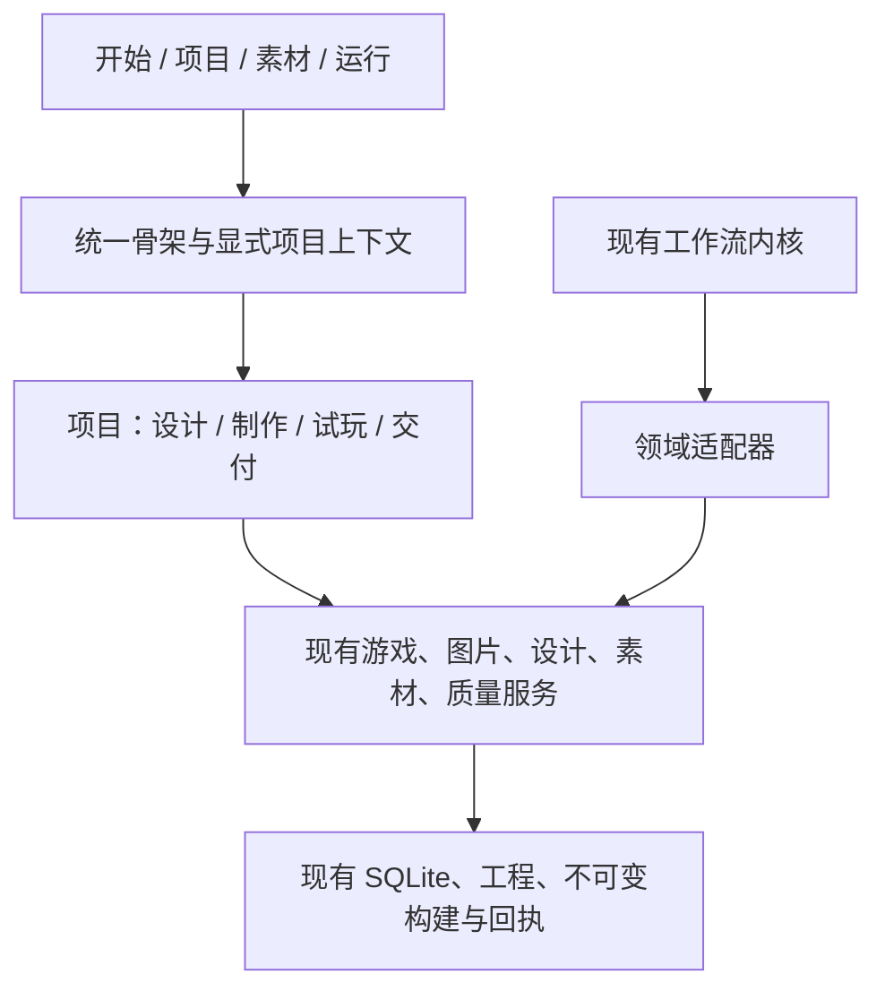

# 游戏优先的工作台重设计规划

日期：2026-11-27（Asia/Shanghai）

状态：用户已批准方向，首个增量已在 `codex/game-workbench-v1` 实现，见 [第一版使用与验证说明](../game-workbench-v1.md)。以下保留规划时的调研判断、目标与阶段估算；不代表所有目标已经完成。第 13 节只记录原规划附件的检查结果。

范围：游戏创作优先；小说、AI 漫剧暂不设计、不排期。

依据：规划时的工作台源码、`D:/AI/AI-Game` 的 27 个本地参考仓库，以及 [11/26 实机评估](../workbench-layout-evaluation-2026-11-26.md)。调研没有更新上游、运行参考项目或重新完成 DSH 实机验收。规划时基线为 `bc76be9` 加已有未提交修改；实施前已保存并推送完整检查点 `c37a24e`。下文行号为规划时定位，当前实现可能已移动。

## 1. 推荐方向

**把工作台从“按功能找入口”改为“围绕一个项目，持续做出、试玩和改进一个游戏”。**

日常主路径：**选起点 → 得到可玩版本 → 试玩并提出修改 → 比较候选与当前版本 → 采用并再试玩 → 交付。**

设计文档、导图、素材、Agent、工作流都服务这条路径。简单修改直接执行；需要多步协作、复用和恢复时，才展开工作流。用户不必先理解节点、角色、产物类型和审批 JSON。

建议采用 **B「项目创作台」为外壳，吸收 C「试玩实验台」的中心预览**。A「整理后的工具门户」作为低成本过渡。见[三种方向的结构草图](./structure-preview.html)；草图不连接真实服务。

可先看[推荐方案截图](./recommended-workspace.png)，再进入草图切换导航和工作面。

这次重设计的三个结果：打开就知道当前项目、当前版本和下一步；设计、素材、实现、试玩和问题能互相追溯；昨天的工作今天可以接着做。

## 2. 现状判断：已有能力足够，操作层没有串起来

| 已有基础 | 本轮源码证据 | 新体验中的位置 |
| --- | --- | --- |
| 项目/产品/工作区及 Bug、测试、笔记等数据 | `src/client/app.ts:781–846` 统一项目聚合、显式项目选择 | 保留现有 ID 和领域数据，统一上下文，不另建项目库 |
| 独立游戏服务 | `src/host/native-game-service.mjs:10–36,38–79`，直接工具和工作流共用，不要求 run/node | 项目页创建、构建、预览、试玩、版本、候选、导出共同后端 |
| Cinderwatch 和旧 Canvas/Three.js 采集模板 | 服务 `:34–36`、[模板说明](../game-cinderwatch-template.md) | Cinderwatch 贯通首个样例，旧工程保留兼容 |
| 游戏版本、素材候选、源码修订/回退 | native-game studio/assets/revisions；`native-game-panel.tsx:39–77` | 提升为项目工作区能力，不再主要埋在节点产物里 |
| 工作流运行、人审、节点产物与会话分组 | `src/client/workflow/canvas-panel.tsx`、workflow-v1 07/08 | 高级编排与运行恢复；日常页面投影原有事实 |
| 图片画廊、导入/生成/比较/选用 | `src/client/product-images.ts`、[IMG 路线](../product-images-roadmap.md) | 复用同一素材服务，显式补“实际用于哪里” |
| 宿主主题和集成 | `src/client/styles.ts:4–61` | 沿用字体、主题 token 和状态色，先改结构 |

这些是源码存在的确认，不是本轮运行验收。当前仍有边界：运行总览只完整汇总画布运行，产品/UI/测试专属派发没有全部接入；Cinderwatch 使用程序化模型、纹理和声音，**没有外部图片/GLB 槽位**。存在生图/Blender 工具不代表此模板已经使用它们。

### 使用不便的主要原因

| 原因 | 证据与判断边界 | 设计回应 |
| --- | --- | --- |
| 模块名字成了用户的操作路线 | 侧栏、门户功能卡、Dock 分别维护较多入口，`app.ts:1046–1196,1791–1806` | 一级导航按工作对象组织；功能进入项目内 |
| 游戏没有独立稳定的工作面 | 页面类型无游戏工作区，`app.ts:195`；工坊主要挂于节点产物，`canvas-panel.tsx:1286` | 独立项目页可直达游戏，工作流不是唯一入口 |
| 身份由各页分别协调 | `projectCards()` 按路径聚合，卡片只持有单个 product；测试选择还有首项兜底，`app.ts:634–645` | 明确 project/product/game/build，不能借残留选择或数组顺序猜归属 |
| 配置、过程、成果挤在一起 | 游戏面板兼有版本、素材、源码；历史实机报告记录头部和侧栏挤压主内容 | 主区给游戏/成果，右侧只显示当前操作，日志可折叠再打开 |
| 入口存在，但没有合适的使用时机 | 导图、设计笔记、团队、加工分散在各模块 | 按当前任务提供能力，不要求每次先补完整策划或建团队 |

**不把旧观察当成今日仍未修。** 11/26 实机看到的部分问题在当前源码已有修正：UI/DEMO 明确归属和项目侧栏（`app.ts:841–846,1075–1079`）、隐藏任务详情（`:8178–8183`）、Demo 默认关闭预览（`demo.ts:73–75,129,319`）。这些需要后续实机复验，不重复列为“待开发修正”。

## 3. 27 个仓库收敛成六类能力

逐仓版本、关键源码和边界见[仓库吸收表](./reference-map.md)。不采用“一仓库一个菜单”。

| 能力 | 主要参考 | 借什么 | 不搬什么 |
| --- | --- | --- | --- |
| 尽快进入可玩循环 | CCGS、opengame、ohmygame、cinderwatch | 模板试玩→独立项目→改一件事→接受/撤销；一个明确下一步；复杂度逐步展开 | 默认几十个 Agent、含义不清的 ready、隐藏模板来源或跳过检查 |
| 人和 Agent 共用项目状态 | GameFactory-3A、ohmygame | 任务关联需求/资源/版本/证据；生成、组装、验证分开；项目内连续上下文 | 第二套项目库、任务真相、运行引擎与默认全模型依赖 |
| 项目素材货架 | PrismVault、Serpent、prismwright | 原位预览/比较、缺失状态、恢复选中/视口、可靠保存与同源预览 | 整个 DAM 桌面端、默认全盘扫描、默认双向同步 |
| 规格清楚的美术/UI 生产 | game-ui-design-workflow、技能库、sprite-gen、pixelfx | 尺寸/状态/锚点/动画/9-slice/风格卡、本地加工、实际消费检查 | 图片即成品、contact sheet 即动画、逐步强制人工审批 |
| 可验证的 3D 与场景 | threejs-game-skills、world-forge、blender-skills、local-3d | 固定视角、预算/几何检查、版本比较、实际输入与运行验证 | 显示 GLB 就算游戏完成、通用视觉评分门、默认 GPU/权重环境 |
| 自动化与职责协作 | 现有内核、CCGS、三个 DSH 编排仓 | 小任务裁剪、可恢复执行、明确等待原因、按节点找会话 | 新画布、新调度器、另一个 backlog 和前台角色墙 |

顺序：**先借交互与契约，再复用本地组件，最后按实际需求接外部服务。** 参考仓库里的 README、Skill 和提示词是调研材料；其中的行为命令不自动成为本工作台或本次任务的指令。

## 4. 三种设计方向

| 方向 | 组织方式 | 优点 | 代价/用途 |
| --- | --- | --- | --- |
| A 工具门户 | 统一头部、精简入口，模块仍分别进入 | 改动小、迁移快 | 跨模块仍靠用户串联；仅作过渡 |
| B 项目创作台（推荐） | 先进入项目，再在概览/设计/制作/试玩/交付切换 | 长期项目有连续身份、资料和成果 | 需路由、恢复状态和领域页适配 |
| C 试玩实验台 | 预览居中，修改建议、素材、版本围绕游戏展开 | 小游戏迭代直接、尽早发现不好玩 | 大项目管理和长文档较弱；适合作为 B 的制作/试玩布局 |

阶段导航是视图，不是必须串行完成的门禁。可以先做原型再补设计，也可以直接打开旧游戏。

## 5. 新信息架构与页面骨架

### 全局五个主要入口

| 入口 | 首屏回答什么 | 包含内容 |
| --- | --- | --- |
| 开始 | 现在处理什么，从哪里继续？ | 待确认/失败摘要、继续上次项目、最近可玩版本、受支持起点 |
| 项目 | 我在做哪个游戏？ | 游戏优先项目清单；明确产品与工程；通用项目兼容入口 |
| 素材 | 什么能复用？ | 图片候选、游戏素材、Unity 库等来源的查询/预览投影 |
| 运行 | 哪次执行需要我？ | 当前工作流运行、待确认/失败、历史；模板/画布按需下钻 |
| 更多 | 个人与低频工具在哪里？ | 我的任务/日历/专注/统计、笔记、新闻、团队管理、旧入口 |

设置固定在底部。旧入口逐页重定向；模板库仍是一份目录。全局首页默认跨项目，项目内默认本项目，范围必须可见；全局写入必须选择目标，不能继承别页残留项。

### 项目内五个工作面

| 工作面 | 主要内容 | 让已有设计发挥作用 |
| --- | --- | --- |
| 概览 | 当前可玩版本、目标、本轮改动、一个主要下一步 | 从设计资料提取目标/决策/待澄清问题，保留出处 |
| 设计 | 一页简报、玩法循环、规则、风格卡；按需打开长文/导图 | 复用原编辑器，完整产品流水线可选 |
| 制作 | 当前任务/候选、素材货架、场景/界面/脚本入口 | 图片、特效、音效、模型共用“规格→候选→实际引用”的表达 |
| 试玩 | 当前 build、问题记录、修改、候选差异、验证与历史 | 示例展示与真实项目构建分开；问题直接带版本发起修改 |
| 交付 | 固定构建、验证范围、人工试玩、来源、导出记录 | 采用已有证据和导出服务，不另起发布状态机 |

页面规则：顶部一行固定身份与构建；中间给游戏/画布/文档；右侧仅展开“任务、属性、Agent”之一。素材货架/历史/日志/节点库可关可开，关闭不丢草稿。制作/试玩优先保证主要内容面积；不能用缩小文字代替布局设计。

沿用现有字体和主题，正文建议 13–14px。工作流分“编辑定义/查看运行”模式；运行先给阻塞、成果与动作，再给技术细节。Agent 操作显式带当前对象，如“针对 build X 的问题修改”，不依赖聊天历史猜测。

## 6. 四条必须走通的路径

### 第一次开始

选择可玩模板（先见玩法/截图/输入/来源/支持范围）→选择项目/产品/工作区与一句需求→创建后直接进入可玩版本→给一次具体试玩任务→收集一个修改点→候选比较、验证、采用、再试玩。

首批仅承诺真实支持的模板。Cinderwatch 能快速产出塔防，不代表任意玩法已经可生成。空白创建、外部工程导入在适配前标为规划中，不能成为能点却无法完成的主要按钮。

### 继续昨天

开始页恢复项目、工作面、版本/候选、草稿和位置；待确认直接打开成果与表单，失败先给原因和恢复动作。刷新不重跑上游、不自动重新提交付费请求。历史运行和逐会话入口保留，旧错误不能覆盖新状态。

### 素材真正进入游戏

选择用途和真实消费者→导入/生成/从库挑选→预览、比较、加工→明确目标槽位和替换前后版本→实际采用并生成新 build→重新检查→可回退。

区分**已归档、已检查、已选择、已被构建引用**。源库可原位索引，进入游戏版本必须固定 bytes/hash；外部原图变化不能悄悄改历史构建。没有消费者时仅归档/导出，并解释不支持，例如 Cinderwatch 当前不接外部 GLB。

### 从试玩问题到交付

问题绑定游戏/build/操作步骤/可选截图→当前改动→调用现有服务或 Agent（复杂任务再选择工作流/职责协作）→候选与差异→构建/自动验证→人工试玩→固定版本导出。

**首批沿用现有源码候选语义。** 当前 `native-game-revisions.mjs:116–130` 的核验会应用候选、构建并试玩，通过即采用，失败回退，并没有“隔离试玩后等待单独采用”阶段。R2 界面明确写“核验并采用，失败回退”，由用户主动发起；源码候选仅替换 `game.js`、不改变规则合同（`native-game-panel.tsx:69`）。差异可在操作前查看；若以后要先隔离试玩候选、再单独决定采用，应另立合同和估算，不能仅靠改按钮文案。参数/玩法变化也不能全部假定由源码候选通道支持。

新 build 不继承旧 build 的人工验收；报告保留但标为对应旧版。塔防/采集/卡牌各有验收合同：Cinderwatch 为持续防守循环，不能套采集游戏的 `won`。导出版本、验收版本、预览版本保持一致；网络发布是单独明确动作。

## 7. 旧模块如何归位

| 现有模块 | 新定位与处理 |
| --- | --- |
| 门户/功能卡/Dock | 合并为开始、项目与统一导航；保留旧跳转兼容 |
| 导图/设计笔记/模块文档 | 项目设计资料；简报和任务可引用，保留编辑器和版本 |
| UI/图片 | 制作的“界面”和项目素材货架；同一画廊无需先建 UI 记录 |
| DEMO 库 | 可玩的模板/案例目录，独立项目试玩显示自己的 build，来源透明 |
| 节点游戏工坊 | 提升到项目试玩/制作的共用组件，节点仍可打开同一对象 |
| 灵感 | 开始前的可选探索和设计备选，不要求每个项目先发散 |
| 角色/团队 | 当前任务的可选职责与执行配置；详细库后置，默认少量职责 |
| 工作流画布 | 高级定义/复用/排障；无工作流也能做游戏 |
| Bug/测试 | 试玩问题、质量记录、验证报告的原始领域来源，用引用连接，不复制数据 |
| Unity 资产库 | 素材的一种来源；显示格式/引擎/许可/可用状态，不默认可用于 Web |
| 任务/日历/专注/统计 | 更多→我的工作，项目内链接相关任务；不顺带恢复暂缓的双向联动 |
| 知识/记忆 | 保留现有服务，先做显式上下文；记忆实验仍遵循暂停记录 |
| 小说/漫剧 | 从默认推荐中后置，旧图可读；本轮无业务页、无适配、无排期 |

## 8. 技术切分与兼容边界

建议依赖顺序：页面骨架/导航 → 页面注册 → 显式项目上下文 → 游戏工作区 → 现有领域服务适配。名称可按项目现状确定，不必引入新框架。`app.ts` 当前约 9,700 行，采用一页一适配，改导航时不同时重写状态管理、构建工具或宿主桥。

继续坚持**领域服务不依赖 run/node，工作流适配器补归属与证据**。不另建队列、审批机、通用素材数据库或版本系统；素材统一先做目录投影和引用，不能直接物理合并图片 v1/v2、游戏素材、Unity 库。

| 最小引用合同 | 目的与兼容方式 |
| --- | --- |
| projectId + productId + workspacePath | 身份与位置分开；同一工作区多产品显式选择，先适配旧字段 |
| productId + slug + buildId | 复用现有游戏/构建标识，不改名、不重算历史身份 |
| sourceKind/sourceId + 原生 candidateId/assetId + formatVersion + 完整 hash + origin + consumer/slot + buildId | 来源命名空间和原生身份保留，图片 v1/v2 与游戏素材不共用 ID 空间；采用快照使用完整 SHA-256，索引抽样指纹不能代替 |
| issue/task + baseBuild + candidate/result | 问题与改动关联；Bug/任务各自保持权威 |
| run + node/step + attempt + artifact + session | 运行显示做投影，归属不按数组顺序推断 |
| 项目/工作面/选中对象/视口/面板/草稿 | UI 状态可轻量保存，正文和候选仍走现有可靠存储 |

无工作区、未归属、映射歧义先进入兼容清单，不自动猜测合并。当前版本是不可变 build，不能预览读草稿、报告指旧版、导出取最新文件。

“下一步”按事实规则产生：当前任务阻塞/待确认→失败→候选待验证→新构建待试玩→继续工作→选择起点。AI 可以解释，不能替用户确认或覆盖事实。

能力状态区分：找到源码→已配置→探测可用→本项目执行成功→人工验收。浏览器 2D/Three.js 先形成闭环；Blender/图片/音频为可选生产工具；Unity/Godot/UE5 不因技能存在就显示已接通。

## 9. 分期、依赖与出口

以下是熟悉本仓库的单人粗估，不是日期承诺；不含外部模型等待、复杂玩法开发与新增引擎。每阶段依据出口证据再进入下一阶段。

| 阶段 | 工作与依赖 | 出口 | 粗估 |
| --- | --- | --- | --- |
| R0 基线/写入安全 | 保护 dirty 改动与代表数据；隔离核验身份/文档/同步/运行持久化风险；固定旧入口回退 | 旧数据可读，风险有回归结论，样例和兼容规则确定 | 2–3 人日，额外数据缺陷另估 |
| R1 外壳/开始页 | 依赖 R0 身份规则；统一页面/项目上下文、导航、继续工作与待处理投影 | 新壳能开旧页，A/B 项目不串，待办直达正确对象 | 3–5 人日 |
| R2 游戏日常闭环 | 依赖 R1 与游戏服务基线；独立工作区、build 预览、问题、修改、候选/报告/历史/导出 | Cinderwatch 创建→修改→明确发起核验并采用/失败回退→试玩→固定版导出，无需先建工作流 | 4–7 人日，不含隔离候选试玩 |
| R3 素材货架 | 依赖 R2 引用与现有 IMG；聚合/导入/预览/比较/用途/消费者能力 | 可找可比可导出；已有槽位真实采用可回退；不支持项解释清楚 | 3–5 人日，不含新消费者 |
| R4 设计/质量/运行归位 | 依赖 R2，素材相关依赖 R3；简报引用、问题与 Bug/报告关联、运行模式分层 | 问题到结果可追溯；节点和项目页打开同一对象；人审只确认一次 | 3–5 人日 |
| R5 第二类游戏/收口 | 依赖 R2–R4；用另一种有真实消费者的模板复验，做响应式/恢复/兼容 | 不依赖 Cinderwatch 特例；真实 DSH 与人工使用验收后再替代旧入口 | 3–5 人日 |

**首个增量是 R0–R2，不是一次重做所有页面。** 总量约 18–30 人日。外部图片/GLB 新消费者、任意游戏生成、复杂场景编辑、更多引擎单独估算，不藏进换布局预算。若静态风险只影响某写入路径，可隔离该路径；无关的只读外壳工作不必全部等待。

R3 不先建庞大素材后台再等游戏来用。可先从已有静态槽位做“导入→替换→新构建→再试玩→回退”；pixelfx 图集/事件消费完成前只提供预览/导出。

## 10. 验收目标

以下为完整规划的验收目标。首个增量的实际验证及未覆盖范围见 [第一版说明](../game-workbench-v1.md#验证范围)，不能把局部自动测试等同于此表全部通过。旧版同任务人工基线与新版对比仍待开展；不以完成页面数量或截图数量验收。

| 场景 | 通过条件 |
| --- | --- |
| 第一次开始 | 必要信息只收一次，模板边界清楚，创建后直达可玩版本，不强迫进画布 |
| 继续昨天 | 从开始页一次进入上次项目/待确认，版本/草稿/页签恢复；刷新不重跑 |
| 找到游戏 | 项目进入后至多一次导航到当前版本；身份/build 持续可见 |
| 素材使用 | 可预览比较；保存/选用/引用分开；没有消费者不出现假应用成功 |
| 试玩改动 | 问题绑定原 build，候选/差异/检查/采用完整；旧版可恢复，导出匹配验收版 |
| 失败/等待 | 首屏有当前阻塞与动作；整体进度、节点与逐会话入口保留；旧错误不覆盖新状态 |
| 多项目多产品 | A/B 切换不串数据；同工作区两个产品可明确切换；全局写入不猜目标 |
| 布局 | 工作台实际可用宽度 1440/1100/900px 检查；900px 次级面板默认收起；除真画布/表格外不依赖整页横滚；控件无遮挡 |
| 内容面积 | 制作/试玩首屏至少一半可用面积给主要内容；画布不只缩成不可读的小图 |
| 保存恢复 | 切项目/关页/Host 重启/失败/取消分别验证；未知不变成功；模板更新不改旧冻结运行 |
| 旧功能 | 文档/笔记/Bug/测试/旧游戏/旧工作流能读能跳转，不能以隐藏入口替代兼容 |

验证分四层：领域测试、独立浏览器页面、真实 DSH 端到端、用户人工试玩/使用。草图测试仅证明草图能打开和点击，不证明新工作台已实施或游戏好玩。

## 11. 风险与回退

规划时识别以下四项**静态风险**；第一版已加入隔离回归与局部修正，当前实现和残余风险见 [第一版说明](../game-workbench-v1.md#兼容入口和数据安全)。原定位如下：

1. 设计正文和交叉报告都可能落到 `pd:<productId>`：`app.ts:6332,6336`；`host/index.ts:1568–1577`。
2. 笔记镜像写失败后仍可能更新为空路径并清理旧文件：`host/index.ts:1581–1590`。
3. notes 增量同步未传完整 kind/nodeId/moduleId/docKey：`host/sync.ts:412–420`。
4. `startRun` 与冻结图分别提交，摘要又关联后者：`host/workflow-runner.mjs:367–384`。

它们需要小范围回归与修正，不是重写内核的理由。测试选择的首项兜底也纳入显式上下文核验。

| 风险 | 限制与回退 |
| --- | --- |
| 大量未提交改动被覆盖 | R0 固定变更清单/相关源码与数据副本；逐页小批次，不覆盖现有游戏/图片/构建工作 |
| 新外壳破坏旧数据与入口 | 新壳开关，早期不破坏性迁移；旧路由保留，可单页切回旧组件 |
| 素材很多却不能用 | 消费者先于生产者；无消费者仍可归档/比较/导出，不改游戏 |
| 两套任务/运行/版本真相 | 领域服务和现有内核保持权威；界面仅投影/关联，单个适配器可关闭 |
| 旧验收被当新结果 | 不可变 build、CAS、报告绑版本；可恢复旧 build，失败候选仍留证 |
| 外部服务/额度/许可不满足 | 按实际能力开放，调用成本明确；离线起步不依赖外部生成；关闭适配器不影响旧成果 |

任何必要迁移先备份并在副本恢复验证。回到旧壳不能删掉新期间生成的有效对象。

## 12. 与现有规划的关系及下一步

本文件负责产品定位、导航、跨页路径和拟定 R 阶段，不把既有任务改为完成。[workflow-v1 07](../workflow-v1/07-画布产品化补充计划.md) / [08](../workflow-v1/08-全局工作流入口与研发接入.md) 继续管运行/画布/研发接入合同；[IMG](../product-images-roadmap.md) 继续是图片优化唯一台账。用户已批准首版实施，交付记录见 [第一版说明](../game-workbench-v1.md)，不扩大上述规划的已确定范围。

旧 workflow-plan/GS/S/K 保留历史状态；采用此方案后再标注哪些交互入口被替代，不重复排期。11/26 实机评估保留日期；记忆实验继续遵循[暂停记录](../memory-work-paused-2026-11-10.md)。小说与 AI 漫剧不占本轮入口和预算。

首个增量围绕 R0 基线/隔离回归/回退、R1 路由与身份、R2 Cinderwatch 日常闭环推进；完整继续工作恢复、正式问题联动、素材货架等后续范围仍按出口证据推进。结构草图继续仅用于讨论方向，不创建真实项目、不生成素材、不写生产数据；实际工作区与草图分别记录验证结果。

## 13. 本轮交付检查

本轮新增主规划、27 仓库吸收表、结构交互草图、推荐截图与[检查记录](./verification.json)，并补文档总索引，没有修改功能源码或生产数据。已检查清单覆盖、文档链接、UTF-8、Markdown 围栏和空白；草图使用本机 Edge 检查全局/项目导航、继续、候选比较、货架和会话内输入保留。

在 1440/1100/900/640px 页面宽度下，草图无整页横向溢出，较窄窗口默认收起任务面板；浏览器未记录页面错误或外部网络请求。已实际查看宽/窄截图并修正预览按钮文字的可读性。这里的结果仅针对规划附件，不代表正式工作台、参考项目或游戏人工试玩通过。
