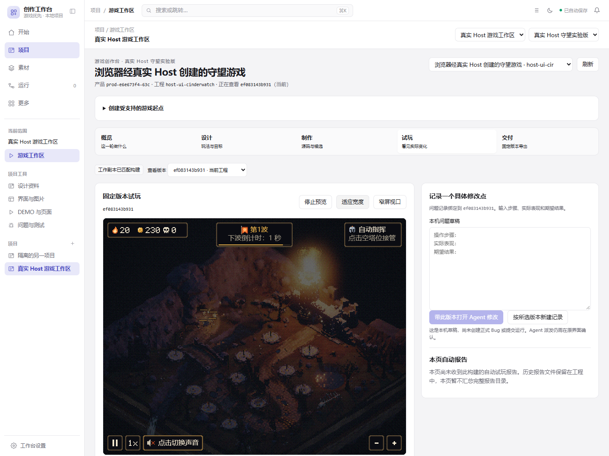

# 游戏工作台第一版

日期：2026-11-27（Asia/Shanghai）

状态：已实现首个增量，位于 `codex/game-workbench-v1`。采用 [重设计规划](game-workbench-redesign/README.md) 的 B 项目创作台外壳与 C 中心试玩方向，交付 R0 写入安全修正、R1 导航与身份上下文、R2 独立游戏工作区的首批能力。尚未完成整份规划的全部出口验收。

## 从哪里开始

一级导航收敛为 **开始 / 项目 / 素材 / 运行 / 更多**，设置保留在侧栏底部。

1. 打开工作台，在“项目”新建或选择一个关联本地工作区的产品。已有产品和数据继续使用原 ID。
2. 点击产品的“进入游戏”。同一项目有多个产品时明确选择目标；“全部项目”和“未归属”不能直接写入游戏工程。
3. 展开“创建受支持的游戏起点”，选择 Cinderwatch、Canvas 采集或 Three.js 采集模板，填写工程名称与 slug。创建会在所选产品的登记工作区内执行。
4. 在 **概览 / 设计 / 制作 / 试玩 / 交付** 五个工作面切换。它们是可自由切换的视图，不要求先完成策划或配置工作流。
5. “试玩”主动启动所选固定构建；“交付”可下载固定构建，或在产品工作区中导出离线 HTML。

“开始”可继续上次有效的项目、产品、游戏工程与工作面。浏览器草稿按产品、工作区和游戏隔离；预览不会因普通外壳刷新或视口按钮重绘而重新启动。离开试玩或切换游戏会停止预览。

## 这一版的工作方式

| 工作面 | 已接通的能力 | 状态边界 |
| --- | --- | --- |
| 概览 | 当前工程、模板、工作副本指纹、固定构建、待核验候选和下一步 | 本轮目标为本机草稿 |
| 设计 | 玩法简报草稿，打开原产品设计资料 | 不强制补全策划；原笔记仍是独立正式记录 |
| 制作 | 读取完整 `game.js`、源码草稿、保存候选、核验、异常候选对账、构建工作副本 | 编辑框不会直接覆盖磁盘；源码通道保持规则合同不变 |
| 试玩 | 固定构建隔离 iframe、适应宽度/窄屏视口、真实浏览器自动检查、带版本打开 Agent 修改 | 本机问题草稿尚未创建正式 Bug；Agent 派发仍需在原派发界面确认 |
| 交付 | 版本历史、固定版本比较/恢复、离线 HTML 导出/下载、报告回执 | 不发布到网络；人工试玩笔记不会被视为服务端验收 |

### 源码修改与回退

先构建工作副本，再以其指纹和 build 为基线编辑完整 `game.js`，填写原因并保存候选。制作页可查看草稿相对基线的修改范围。保存候选本身不改变当前工程。

**“核验并采用，失败回退”会实际应用候选、构建并启动本机浏览器检查；通过即采用，失败回退。** 这里没有独立的“隔离核验通过后，再按一次采用”阶段。若执行中断或出现指纹冲突，应先刷新状态；界面提供显式对账，不把未知状态显示为成功。

基线改变时保留原草稿并阻止陈旧候选提交。需要重新载入当前源码时，先复制仍需保留的修改，再使用“以当前工程重新载入源码”。构建按钮只构建磁盘工程，不会应用编辑框内容。

源码候选只替换 `game.js`。新增资源消费槽、修改规则合同或更换引擎需要另行适配，不能仅通过修改按钮文案实现。

### 素材和报告

“素材”先聚合现有项目图片、游戏工程素材入口与 Unity 已购库。图片画廊保留导入、生成、比较、选用等既有能力；生成仍遵循原有渠道与额度确认流程。

Cinderwatch 当前使用程序化场景、纹理与声音，**没有外部图片或 GLB 消费槽**。归档、选中图片不表示此模板已经引用它。Unity 资产也不自动变成 Web 游戏可用资源。新素材加工与消费者集成仍按 [IMG 路线](product-images-roadmap.md) 和 R3 推进。

自动报告只展示本页实际收到、且与当前所选 build 精确匹配的回执；工程中的历史报告仍保留，本页尚未提供完整报告目录。自动检查、人工体验和最终交付分别记录。

## 兼容入口和数据安全

- “更多”保留任务、看板、日历、专注、统计、产品设计、UI、DEMO、Bug、测试、笔记、新闻和团队入口；“更多 → 旧版门户”保留原门户组件。
- “运行”使用原运行中心和工作流内核。日常创建、修改、试玩和导出不需要先建立工作流。
- 项目切换清理过时的领域选择，并拒绝迟到响应污染新项目。多产品、多测试项目不再通过数组首项猜归属。
- 设计正文使用 `pd:<productId>`，交叉检查报告使用显式 `pdr:<productId>`。Agent 工具 schema 与处理器均传递 `kind/docKey`。
- 笔记镜像先写临时文件再原子替换；镜像失败时保留原 DB 和旧文件。手工保存与同步保留省略的 `mapId/kind/nodeId/moduleId/docKey`，显式空值仍可清除。
- 工作流运行和冻结图使用同一既有内核事务保存，避免只写入其中一个。

本次没有迁移生产库，也没有修改生产运行或记忆数据。镜像文件替换成功之后若数据库写入再失败，仍可能出现文件与 DB 不一致；本增量没有引入跨文件与数据库的分布式事务。

## 验证范围

以下测试均使用隔离临时数据。R0 使用隔离临时 Host bundle；真实 Host HTTP/浏览器测试加载 `lib/index.js`，注册真实 HTTP 处理器并读写临时 SQLite/游戏文件；不是生产 DSH 会话。

| 命令 | 覆盖范围 |
| --- | --- |
| `npm run bundle:host`、`npm run bundle:client` | Host 与客户端构建 |
| `npm run verify` | 原 bundle/news/assets/policy/workflow/game 回归，加 R0 故障注入、新领域 HTTP 和真实构建 Host HTTP |
| `npm run verify:game-workbench:v1:browser` | 真实客户端源码配 HTTP fixtures：导航、显式身份、异步切换、草稿 CAS、iframe 连续性、创建/导出及 900px 布局 |
| `npm run verify:game-workbench:v1:host-browser` | 真实客户端 + 构建 Host + Cinderwatch Three.js/WebGL2：创建、预览、源码候选核验、失败回退和固定版导出 |
| `node scripts/verify-product-images-mount.mjs` | 原图片应用挂载、轮询、草稿和归属回归 |
| `npm run verify:workflow:hub` | 原运行中心与 Host 联动回归 |
| `npm run verify:game-studio:extensions` | 原版本/素材/Blender/源码修订/管理器/面板/取消回归 |

浏览器测试仅替换无关 React 画布挂载，保留实际工作台和游戏工作区源码。真实 Host 浏览器测试运行实际 Cinderwatch 产物；浏览器与自动检查运行时需在本机已安装，不自动下载依赖、不调用外部生成渠道。

本轮 [精简验证记录](game-workbench-redesign/implemented-verification.json) 保留通过命令、真实 Host 请求数量、采用/回退构建标识与未覆盖范围；原始自动试玩回执和截图由测试脚本输出到忽略的 `.tmp-game-workspace-v1-host-evidence/`，可按同一命令重新生成。

图：本机 Edge 中的真实客户端与隔离 Host，运行实际 Cinderwatch 游戏。此截图不是生产 DSH 实机验收，也不表示游戏人工体验通过。

## 待完成的验收与后续增量

1. **真实 DSH 使用验收**：加载本分支插件，在日常主题和面板尺寸下检查原数据可读、A/B 项目切换、关闭/重开及 Host 重启后的恢复。
2. **人工游戏验收**：在目标设备实际建造、出兵/波次、经济循环、胜负与输入操作，并对照准确 build 检查导出文件。
3. **下一增量**：正式问题/Bug 与改动关联、完整历史报告索引、素材货架及真实消费者、待处理直达与更完整的继续工作恢复。
4. **后续收口**：第二类游戏完整复验、更多面板宽度和主题、旧入口切换策略。小说与 AI 漫剧继续暂缓。

本轮通过的自动检查不替代上述人工或生产宿主验收，也不把 R3–R5、workflow-v1 或 IMG 既有任务追溯标为完成。

## 回退办法

现有完整版本先保存到 `feat/news-extension`，检查点为 `c37a24e`；新工作均在 `codex/game-workbench-v1`。需要回到上一版时，先保存当前修改，再切换旧分支并重新构建/加载插件。不要使用强制重置清除新增工程或本地资料。

只需找回旧功能时可使用“更多 → 旧版门户”；它保留原门户组件，但不是全局旧侧栏开关。新版本生成的有效工程、构建和候选仍由既有领域服务保存，回退界面不应删除它们。
